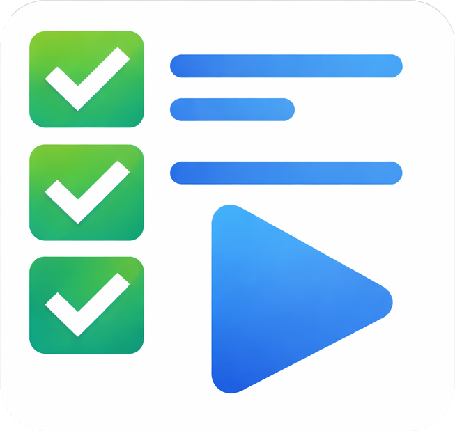
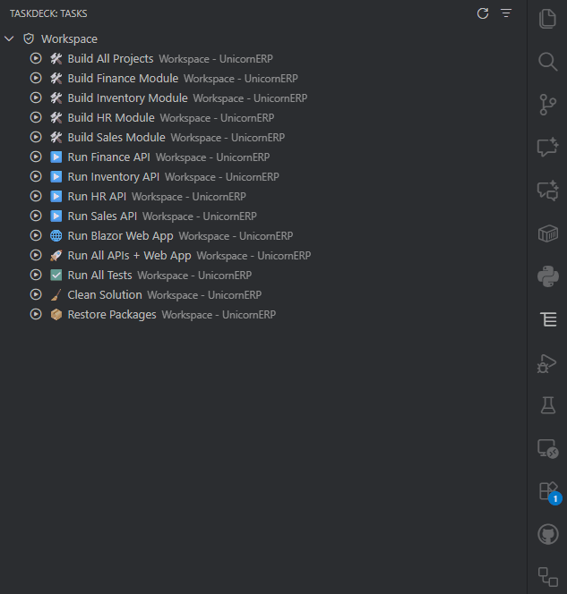

   
    

A control center to manage and launch VS Code tasks with an elegant side panel interface.

   

## Features

TaskDeck provides a dedicated Activity Bar view container that brings all your VS Code tasks to your fingertips with powerful organization and management features:

### V1 Features

1. **Task Explorer Side Panel**
   - Dedicated Activity Bar icon with "TaskDeck" container
   - Tree view showing all workspace tasks
   - Task information displayed: name, source (npm, shell, workspace, etc.), and folder (in multi-root workspaces)
   - One-click task execution
   - Multi-select tasks to start or stop them together
   - Visual grouping: Favorites, Recent, and All Tasks

2. **Favorites & Pinning**
   - Mark tasks as favorites with a simple context menu action
   - Favorites persist across VS Code sessions
   - Favorites appear at the top of the task list with star icons
   - Toggle favorite status with "TaskDeck: Toggle Favorite" command

3. **Recent Tasks History**
   - Automatically tracks last 20 task executions
   - Shows recently run tasks in a dedicated section
   - Displays exit codes and timestamps
   - Quick access to frequently used tasks

4. **Search & Filter**
   - Filter tasks by name, source, or folder
   - "TaskDeck: Set Filter" command with input dialog
   - Real-time filtering in tree view
   - Case-insensitive search

5. **Command Palette Integration**
   - "TaskDeck: Run Task…" command for quick task execution
   - Smart ordering: Favorites → Recents → All Tasks
   - Visual icons distinguish task types

6. **Status Bar Integration**
   - Shows running task status in status bar
   - Click to focus terminal
   - Success/failure indicators with exit codes
   - Auto-hides after task completion

7. **Context Menu Actions**
   - Run Task
   - Toggle Favorite
   - Quick access from tree view

### New: npm Scripts Category

- Automatically detects all `package.json` files in your workspace and lists their scripts in a dedicated **"npm scripts"** group.
- Shows extra context for each script: **folder** (relative path inside the workspace) and **workspace path**.
- Scripts are executable like any other task with one click.
- Built-in VS Code npm tasks are filtered out to avoid duplicates — TaskDeck shows enhanced npm entries instead.
- Task lists refresh automatically when workspace task files, package manifests, Ant build files, or workspace folders change.
- Script execution honors a package's `packageManager` field or the nearest npm, pnpm, Yarn, or Bun lockfile (falling back to npm).
- Scripts are grouped by workspace and package so identically named scripts are easy to tell apart.

### Running Tasks and History

- Active executions appear in a **Running** group, including multiple concurrent runs.
- Use Ctrl/Cmd-click to select multiple task rows, then use the play or stop action in the view title to run selected tasks or stop selected running tasks.
- Stop or restart a running task from its row actions.
- Focus the task's terminal from the running task menu. If VS Code does not expose a matching task terminal, TaskDeck focuses the active terminal.
- History records one entry per run with its outcome, exit code, completion time, and duration.
- **Open Task Definition** opens the corresponding `package.json`, `build.xml`, or workspace `tasks.json` when available.

### Filtering

- The filter searches task name, source, package/folder, and workspace.
- While a filter is active, use the close icon in the view title or **TaskDeck: Clear Filter** to clear it.
- Routine actions such as running a task, pinning, and favoriting do not interrupt with informational popups.

### New: Send to Taskbar

- **Pin any task to the VS Code status bar (taskbar) for one-click access!**
- Use the new **pin icon** (📌) inline action in the TaskDeck tree view to send a task to the taskbar, just like the run (▶️) and favorite (★) icons.
- Pinned tasks appear as buttons in the VS Code status bar. Click to run instantly.
- Right-click a task or use the inline pin icon to toggle pin/unpin.
- Pinned tasks persist across VS Code sessions.

### New: Pinned Category in Tree

- Pinned tasks now appear in a dedicated **Pinned** section in the tree, shown below **Favorites**.
- Pinned tasks are excluded from **Recent** and other source groups to avoid duplication.

## Usage

1. Click the TaskDeck icon in the Activity Bar to open the side panel
2. Browse tasks organized by Running, Favorites, Pinned, Recent, and task source
3. Use the **inline icons** next to each task:
   - ▶️ Run Task
   - ★ Toggle Favorite
   - 📌 Send to Taskbar
4. Pinned tasks appear as buttons in the VS Code status bar (bottom left)
5. Click a status bar button to run the task instantly
6. Right-click tasks for context menu options
7. Use the filter icon to search for specific tasks
8. Use Command Palette (`Ctrl+Shift+P` / `Cmd+Shift+P`) and type "TaskDeck" to access all commands

## Commands

- `TaskDeck: Refresh Tasks` - Reload all tasks from workspace
- `TaskDeck: Run Task…` - Open quick pick to select and run a task
- `TaskDeck: Set Filter` - Filter visible tasks
- `TaskDeck: Clear Filter` - Clear the active filter
- `TaskDeck: Toggle Favorite` - Add/remove task from favorites
- `TaskDeck: Run Task` - Run a specific task (context menu)
- `TaskDeck: Send to Taskbar` - Pin/unpin a task to the VS Code status bar for quick access
- `TaskDeck: Stop Running Task` - Stop a selected running task
- `TaskDeck: Run Selected Tasks` - Start all selected tasks
- `TaskDeck: Stop Selected Tasks` - Stop all selected running tasks
- `TaskDeck: Restart Running Task` - Restart a selected running task
- `TaskDeck: Focus Task Terminal` - Focus the selected running task's terminal
- `TaskDeck: Open Task Definition` - Open the source file for a task when available

## Requirements

- VS Code 1.106.0 or higher

## Extension Settings

This extension stores data in VS Code's global state:
- `taskdeck.favorites` - List of favorite task IDs
- `taskdeck.history` - Recent task execution history (last 20 entries)
- `taskdeck.taskbarPinned` - List of task IDs pinned to the status bar

The `taskdeck.excludeSources` setting applies consistently to the tree, Quick Pick, and pinned status bar items.
Npm scripts use their package's `packageManager` field first, then the nearest recognized lockfile, and finally npm.

## Known Issues

None at this time.

## Release Notes

### 0.9.0

Initial release of TaskDeck with all V1 features:
- Task Explorer side panel
- Favorites and pinning
- Recent tasks history
- Search and filter
- Command palette integration
- Status bar integration
- Context menu actions

### 0.11.0

- Added "npm scripts" category with workspace/folder context.
- Added "Pinned" category in the tree below Favorites.
- Quick Pick updated with sections for Favorites, Pinned, Recent, npm scripts, and All Tasks.
- Filtered out built-in npm tasks to avoid duplicates.

### 0.10.0

- Added "Send to Taskbar" feature with inline pin icon and status bar integration

---

**Enjoy managing your tasks with TaskDeck!**
